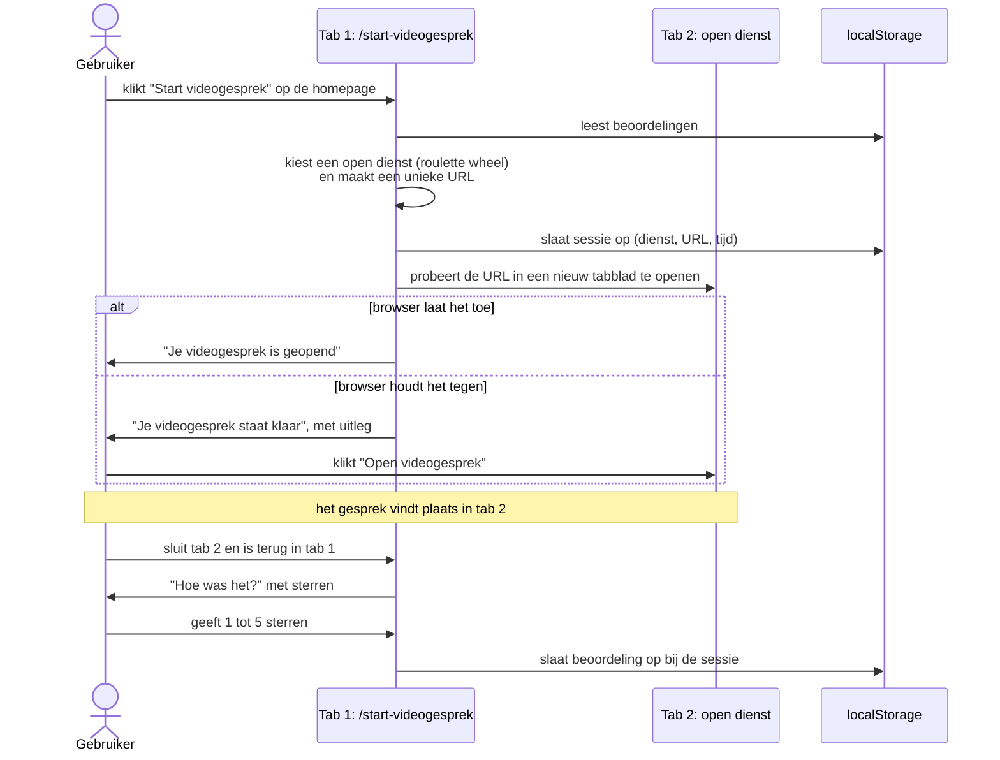

# Architectuur

Dit document beschrijft wat OpenDiensten is, welke begrippen we gebruiken en hoe het werkt. Het is de uitwerking van de productvisie in de [README](../README.md).

## Doel

OpenDiensten is een overzicht van **open diensten**: online diensten die iedereen meteen kan gebruiken, zonder ze zelf te hosten. Denk aan videobellen, samen schrijven, plannen en brainstormen. Voor wie een vereniging, buurt of initiatief organiseert, is het een startpagina voor goede publieke tech. Daarnaast kun je met één klik meteen beginnen: een videogesprek of een gedeeld document starten bij een open dienst.

## Begrippen

### Open dienst

Een **open dienst** is een online dienst die:

- **gratis** is, en
- **zonder verplichte login** toegankelijk is.

Vaak werkt een open dienst met een unieke, moeilijk te raden URL per bestand, kanaal of gesprek. Wie de URL heeft, kan meedoen; wie hem niet heeft, kan hem niet vinden. Daardoor heb je geen account nodig en kun je een link gewoon delen.

### Open source en open standaarden

Een open dienst draait bij voorkeur op **open source software** of **open standaarden** (bijvoorbeeld Jitsi Meet, Etherpad of Nextcloud). Dat is belangrijk vanwege **digitale autonomie** en **leveranciersonafhankelijkheid**: als een aanbieder stopt of verandert, kun je met dezelfde software naar een andere aanbieder of het zelf hosten. In de data staat de onderliggende software in het veld `software`.

### Aanbieder

Een open dienst wordt altijd aangeboden door een **aanbieder**: de organisatie die de software host en beschikbaar stelt (bijvoorbeeld Stichting Pleio, Framasoft of Disroot). Dezelfde software kan door meerdere aanbieders worden aangeboden; elke combinatie van software en aanbieder is een aparte open dienst.

### Dienst, software en organisatie

Een kaartje op de site is altijd een **dienst**: iets wat je gebruikt, op een bepaalde plek. `social.codefor.nl` is een dienst; die draait op de **software** Mastodon en wordt aangeboden door de **organisatie** Code for NL. Daarom is de naam van een dienst de plek waar hij staat (`meetme.bit.nl`, `codefornl.slack.com`), of de eigen naam van de dienst, en nooit de naam van de software. Software en organisaties staan elk in een eigen lijst, waar diensten met een id naar verwijzen (zie [Data](#data-diensten-profielen-en-het-register)).

### Europees of niet-Europees

Een aanbieder is een **Europese** of een **niet-Europese** partij. Dat is belangrijk vanwege **soevereiniteit**: onder welke wetgeving vallen je gegevens, en wie kan erbij? In de data staat dit in het veld `eu_hosting`; op de site staat het als label: europees of niet europees.

### Profiel

Een **profiel** laat zien welke diensten een organisatie (bijvoorbeeld Code for NL) gebruikt: per categorie de open diensten die zij als default kiest, één of meer in volgorde van voorkeur, en wat zij (nog) gebruikt dat geen open dienst is. Een profiel heeft drie doelen:

- **Wegwijzer.** Voor de mensen in de organisatie: waarvoor moet ik waar zijn? Ook als dat (nog) geen open dienst is; daarom staat zo'n dienst er met een link bij.
- **Roadmap naar digitale autonomie.** Elke dienst is een zeshoek: vol voor een open dienst, leeg voor wat het nog niet is ("5 van 6 open"). Bij elke dienst die geen open dienst is, staat waarom (account nodig, gesloten software, aanbieder buiten de EU) en wat het open alternatief is, of de vraag of iemand er een kent.
- **Inspiratie.** Andere organisaties zien welke diensten een vergelijkbare organisatie kiest.
- **Doorverwijzen.** Een organisatie stuurt haar mensen naar `opendiensten.nl/?profiel=codefornl`. Dat is de pagina Diensten met een filter: bovenaan de organisatie, daaronder alleen de categorieën en diensten die zij kiest. De startknoppen kiezen dan alleen uit de diensten van dat profiel; staan er meer in een categorie, dan op basis van beoordelingen. Op `/profielen/` staat een tegel per profiel.

## Data: diensten, profielen en het register

Alles is JSON, met een JSON Schema dat we publiceren, zodat een organisatie haar profiel ook zelf kan bijhouden. De schema's staan in [`_data/schemas/`](../_data/schemas/), zodat Liquid ze kan lezen: de pagina [`/gegevensmodel`](../pages/gegevensmodel.html) maakt de veldtabellen er rechtstreeks uit (`organisms/schema-table.html`), met links naar alle bestanden. `pages/schemas/` publiceert ze op `/schemas/<naam>.schema.json`.

| schema | wat | gepubliceerd op |
|---|---|---|
| [`dienst.schema.json`](../_data/schemas/dienst.json) | één dienst, open of niet | `/schemas/dienst.schema.json` |
| [`profiel.schema.json`](../_data/schemas/profiel.json) | een organisatie en de diensten die ze gebruikt | `/schemas/profiel.schema.json` |
| [`register.schema.json`](../_data/schemas/register.json) | de lijst van profielen die we inladen | `/schemas/register.schema.json` |
| [`software.schema.json`](../_data/schemas/software.json) | de software waar diensten op draaien | `/schemas/software.schema.json` |
| [`organisaties.schema.json`](../_data/schemas/organisaties.json) | de organisaties die diensten aanbieden of beheren | `/schemas/organisaties.schema.json` |

### Alle diensten

De catalogus van OpenDiensten is zelf een profiel: [`_data/profielen/open-diensten.json`](../_data/profielen/open-diensten.json), gepubliceerd op `/profielen/open-diensten.json`. Erin staan de open diensten, en ook bekende diensten die geen open dienst zijn (Slack, WhatsApp, GitHub, LinkedIn, …) met `open: false` en de redenen. Andere profielen verwijzen ernaar, zodat ze de gegevens van een dienst niet opnieuw hoeven in te voeren. De pagina Diensten toont dit profiel, aangevuld met wat in de andere profielen staat.

### Een dienst

| veld | betekenis | begrip |
|---|---|---|
| `id` | vaste sleutel, bv. `jitsi-meet-pleio`; verwijzingen gebruiken hem, dus verander een bestaande id nooit | |
| `naam` | de dienst: de plek waar hij staat (`social.codefor.nl`) of zijn eigen naam; niet de software | dienst |
| `software` | id uit de lijst software (`mastodon`) | open source / standaarden |
| `aanbieder` | id uit de lijst organisaties (`codefornl`) | aanbieder |
| `eu_hosting` | `true` = gehost in de EU, bij een Europese partij | soevereiniteit |
| `doelgroep` | alleen als de dienst niet voor iedereen is, bv. `overheden` | |
| `beheer` | id van de organisatie die de dienst als managed service beheert, bv. `procolix` | |
| `soort` | `dienst` (standaard) of `infrastructuur` (domeinnamen, nieuwsbrieven): daar geldt het oordeel open dienst niet | |
| `categorie` | soort dienst, bv. `videobellen`, `samen-schrijven` | |
| `url` | de dienst zelf | |
| `random_url` | basis-URL om een nieuwe, unieke URL te maken (alleen als de dienst dat kan) | open dienst |
| `beschrijving`, `spoelkeuken_url` | weergave en verwijzingen | |
| `favicon` | alleen voor een dienst zonder software; anders komt het logo van de software | |
| `status` | `live` (standaard), `disabled` of `discontinued`; alleen `live` wordt getoond | |
| `open` | `true` (standaard): een open dienst. `false`: iets wat een organisatie gebruikt dat geen open dienst is | open dienst |
| `redenen` | bij `open: false`: `account`, `betaald`, `gesloten`, `buiten-eu` | |

### Software en organisaties

- **[`_data/software.json`](../_data/software.json)** ([schema](../_data/schemas/software.json), op `/software.json`): de software waar diensten op draaien, met `id`, `naam`, `logo`, `website`, `broncode` (de repository, op GitHub, GitLab, Codeberg, Framagit, …) en `open_source`: software die je zelf kunt draaien of installeren. Meestal open source; een gesloten product (zoals Word) kan er ook in, met `open_source: false`. Wat alleen als dienst bestaat (Slack, LinkedIn, GitHub), staat er niet in: zo'n dienst heeft geen `software`.
- **[`_data/organisaties.json`](../_data/organisaties.json)** ([schema](../_data/schemas/organisaties.json), op `/organisaties.json`): de organisaties die diensten aanbieden, met `id`, `naam`, `website`, `logo` en `land` (ISO-code, bv. `NL`). Het logo staat klein bij elke dienst van die aanbieder.
- **De twee logo's op een kaartje** komen uit deze lijsten: groot het logo van de software, klein rechtsonder dat van de aanbieder (`atoms/favicon.html`). Alleen een dienst zonder software (Slack, LinkedIn) heeft een eigen `favicon`. Op de pagina van een software staat de broncode met het logo van de codeplek (`atoms/broncode.html`, logo's in `assets/images/forges/`).
- **Verwijzen.** Een dienst zegt `"software": "mastodon"` en `"aanbieder": "codefornl"`. Die id's moeten bestaan; `scripts/profielen.rb controleer` controleert dat, ook voor opgehaalde profielen. Een organisatie die een eigen profiel publiceert, vraagt ons dus om haar software en aanbieders toe te voegen, als die er nog niet in staan.
- **Aanbieders-pagina's.** Onder Aanbieders (onder Software in het menu) staat `/aanbieders/`: een tegel per organisatie met land (en het label europees of niet europees) en diensten, in twee groepen (aanbieders van open diensten, en van alleen diensten die niet open zijn). Elke aanbieder heeft een pagina `/aanbieders/<id>/` met haar diensten, en een link naar haar profiel als ze er een heeft (Code for NL). Net als bij software is elke pagina een klein bestand `_aanbieders/<id>.md` (collection `aanbieders`, layout `aanbieder`).
- **Managed service.** Een dienst kan met `beheer` zeggen wie hem technisch beheert (ProcoliX beheert Mastodon voor social.codefor.nl, mastodon.nl en cultuur.social). De pagina van de software toont per beheerder voor welke diensten; de pagina van de beheerder toont wat ze beheert.
- **Software-pagina's.** Onder Software (onderaan het menu) staat `/software/`: een tegel per software, in groepen (open source, gesloten producten als die er zijn, nog zonder dienst). Elke software heeft een eigen pagina `/software/<id>/` met de diensten die erop draaien, wie ze gebruikt, en bij gesloten software de open alternatieven per onderwerp. GitHub Pages draait geen eigen plugins, dus elke pagina is een klein bestand `_software/<id>.md` (collection `software`, layout `software`); `ruby scripts/profielen.rb paginas` maakt ontbrekende pagina's aan (software en aanbieders), en `controleer` meldt wat ontbreekt.
- **Labels.** Elke dienst heeft vier labels (`molecules/dienst-tags.html`), goed (groen, met een vinkje) of niet (grijze rand): open source / closed source (van de software), europees / niet europees (`eu_hosting`), open dienst / login vereist (en niet gratis, uit de `redenen`), voor iedereen / beperkte doelgroep (`doelgroep`, bv. `overheden` voor code.overheid.nl; Start kiest zo'n dienst niet, tenzij een profiel hem kiest).
- **Bij elke dienst** staat onder de naam "Nextcloud door Disroot": software en aanbieder, naast hun logo's, elk met een link naar hun pagina. De categorie staat oranje rechtsboven op het kaartje. De naam van de dienst is de link naar de dienst en ligt over het hele kaartje (`a.card-link`), zodat software en aanbieder eigen links kunnen zijn. Wie de dienst gebruikt, staat in de strook eronder (`molecules/service-strip.html`).
- **Op de site** zet Liquid de namen erbij (`_includes/data/dienst.html`); `/diensten.json` levert ze voor de JavaScript al ingevuld (`aanbieder` en `software` als naam, met `aanbieder_id`, `software_id` en `aanbieder_favicon`).

### Een profiel

```json
{
  "$schema": "https://opendiensten.nl/schemas/profiel.schema.json",
  "versie": 1,
  "id": "codefornl",
  "naam": "Code for NL",
  "beschrijving": "…",
  "website": "https://www.codefor.nl",
  "logo": "/assets/images/logos/codefornl.png",
  "diensten": [
    { "ref": "jitsi-meet-pleio" },
    { "id": "mastodon", "naam": "social.codefor.nl", "software": "mastodon", "categorie": "sociale-media",
      "url": "https://social.codefor.nl", "aanbieder": "codefornl", "eu_hosting": true },
    { "ref": "linkedin", "url": "https://www.linkedin.com/company/codefornl/" }
  ]
}
```

- **Een verwijzing** `{"ref": "<id>"}` neemt een dienst over uit Alle diensten, of met `"bron": "<url>"` uit een ander profiel in het register.
- **Een organisatiespecifieke url** (`"url"` in een verwijzing) kan alleen bij een dienst die geen open dienst is: jullie pagina op LinkedIn, jullie Slack-werkruimte. Het kaartje in het profiel gaat daarheen en toont die url; in het algemene overzicht staat de algemene dienst. Een open dienst heeft geen eigen url per organisatie: je maakt er steeds een nieuwe, unieke link mee. `scripts/profielen.rb` controleert dat.
- **Een volledige dienst** staat er gewoon in; dat is voor wat niet in Alle diensten staat, zoals een eigen server (`social.codefor.nl`).
- **Volgorde.** De volgorde binnen een categorie is de volgorde van voorkeur.
- **Alleen op aanvraag.** Een profiel komt er pas op als de organisatie daarom vraagt; er is geen label concept of bevestigd.

Wat geen open dienst is, staat op Diensten en in het profiel na de open diensten, met een dikke zwarte rand en de redenen als labels (account nodig, niet gratis, niet open source, niet Europees). **Foute opties komen uit profielen**, niet uit de algemene selectie: closed source diensten die niet open zijn (Slack, WhatsApp, GitHub, LinkedIn) staan in Alle diensten zodat profielen ernaar kunnen verwijzen, maar op Diensten alleen als een profiel ze gebruikt. Wat niet open is maar wel open source (Signal, Element), staat er altijd. De startpagina kiest ze nooit.

**Infrastructuur** (`"soort": "infrastructuur"`): domeinnamen, nieuwsbrieven en dergelijke (TransIP, mijn.host, LaPosta). Daar betaal je meestal voor, dus de vraag of het een open dienst is, speelt niet: geen zwarte rand en geen label open dienst / login vereist, wel het label infrastructuur, europees en open source. Ze staan na de open diensten, tellen niet mee in de autonomiemeter, en Start kiest ze nooit. Een profiel kan er een eigen `url` bij geven, net als bij een dienst die niet open is.

### Het register

[`_data/profielregister.json`](../_data/profielregister.json) zegt welke profielen er zijn en waar ze staan. Het staat ook op `/profielen/register.json`.

```json
{ "versie": 1, "standaard": "open-diensten",
  "profielen": [ { "id": "codefornl", "url": "https://opendiensten.nl/profielen/codefornl.json" } ] }
```

- **Profielen op `https://opendiensten.nl/profielen/`** beheren we zelf, in `_data/profielen/<id>.json`, met een kleine pagina in `pages/profielen/<id>.json` die ze publiceert.
- **Uitleg voor organisaties** staat op [`/profielen/toevoegen`](../pages/profiel-toevoegen.html): de twee manieren, de stappen, een volledig voorbeeld, alle velden en de ids van alle open diensten.
- **Een organisatie kan haar profiel ook zelf publiceren**, bijvoorbeeld op `https://<domein>/.well-known/opendiensten.json`. Dan staat die URL in het register. Elke nacht haalt een GitHub Action ([`.github/workflows/profielen.yml`](../.github/workflows/profielen.yml)) zulke profielen op met [`scripts/profielen.rb`](../scripts/profielen.rb), controleert ze en zet ze in `_data/profielen/`. Klopt een profiel niet, dan blijft de vorige versie staan.
- **Controleren** doe je met `ruby scripts/profielen.rb controleer`: schema's, verwijzingen, dubbele id's, en geen HTML in tekst. De Action doet dat bij elke wijziging.

## Overzicht van open diensten

Of een dienst gratis is en zonder login werkt, bepaalt of hij een open dienst is (`open`). Of de software open source is, staat bij de software (`open_source` in `_data/software.json`).

De pagina Diensten ([`index.md`](../index.md)) toont alles uit alle profielen samen, per categorie onder een eigen kop, in één raster: eerst de open diensten (die uit Alle diensten, dan die alleen in een ander profiel staan; een dienst met dezelfde url komt er één keer in), dan wat geen open dienst is, met een dikke zwarte rand en de labels. Bij elke dienst staan de logo's van de organisaties die hem gebruiken, met een link naar hun profiel. Het menu onder Diensten in de zijbalk bestaat uit ankers naar die koppen (`#videobellen`). Met `?profiel=<id>` filtert [`js/opendienstenapp.js`](../js/opendienstenapp.js) dezelfde weergave op wat één organisatie gebruikt; Jekyll zet daarvoor per profiel verborgen blokken klaar. Dezelfde data is beschikbaar als JSON op `/diensten.json` (alles), `/api.json` (alleen live, met metadata) en `/profielen.json` (de profielen).

## "Start videogesprek" en "Start samen schrijven"

Met deze knoppen begin je meteen, zonder zelf een dienst te kiezen. Hieronder staat de flow voor videobellen; samen schrijven werkt hetzelfde, met `/start-samen-schrijven` en een document in plaats van een gespreksruimte. Elke categoriepagina (`/videobellen`, `/plannen`, …) werkt ook zo.

De startpagina is de plek voor de hele sessie: daar kies je, open je, deel je de link en beoordeel je na afloop. De homepage hoeft niets te onthouden.



1. **Klik.** De knop op de homepage is een gewone link naar `/start-videogesprek`, in hetzelfde tabblad.
2. **Kiezen.** De startpagina kiest een open dienst uit de categorie met **roulette wheel selection** op basis van de beoordelingen (zie hieronder), en maakt een unieke URL op die dienst: een nieuwe gespreksruimte of een nieuw document, op basis van `random_url`. Heeft een categorie diensten met `random_url`, dan wordt alleen daaruit gekozen.
3. **Bijhouden.** Alleen als de gebruiker de geschiedenis bijhoudt (standaard uit; zie [Opslag](#opslag)): dan wordt de sessie (welke dienst, welke URL, wanneer) opgeslagen in `localStorage`, en de adresbalk wordt `/start-videogesprek?sessie=<sessie>`, zodat herladen dezelfde sessie laat zien.
4. **Openen.** De pagina probeert de unieke URL in een nieuw tabblad te openen. Browsers houden dat meestal tegen, omdat het niet direct op een klik volgt. Dan legt de pagina uit wat er gekozen is en waarom, en geeft de gebruiker de knop "Open videogesprek". Een klik op een knop wordt nooit tegengehouden.
5. **Delen.** De unieke URL staat op de pagina, met een kopieerknop, zodat je anderen kunt uitnodigen.
6. **Beoordelen.** Na het gesprek sluit de gebruiker het tabblad met de open dienst en is terug op de startpagina, waar de sterren klaarstaan.
7. **Meewegen.** De beoordeling wordt opgeslagen (bij de sessie, of zonder geschiedenis als telling per dienst) en weegt de volgende keer mee in de roulette wheel selection.

Bevalt de gekozen dienst niet, dan kiest "Kies een andere dienst" opnieuw, zonder de vorige. Een sessie die nog niet beoordeeld is, kun je later beoordelen via de geschiedenis: die linkt naar `/start-videogesprek?sessie=<sessie>`.

### Unieke URL's

Een open dienst werkt vaak met een moeilijk te raden URL: wie de URL heeft, kan meedoen. Voor een dienst met `random_url` maken we die URL zelf: `random_url` + 16 tekens uit een cryptografische bron (`crypto.getRandomValues`), ongeveer 80 bits, zonder voorvoegsel. Bijvoorbeeld `https://meetme.bit.nl/k7m2q9xw4hr8tn3v`. Diensten zonder `random_url` krijgen hun gewone URL.

Dat gebeurt op twee plekken:

- **Op de startpagina**, zoals hierboven beschreven.
- **Bij een klik op een dienstkaart** op Diensten. Kan de dienst een eigen ruimte of document maken, dan staat er "eigen link" op de kaart. Een klik maakt een unieke URL in plaats van naar de algemene link te gaan, en zet de sessie in de geschiedenis als de gebruiker die bijhoudt. [`js/opendienstenapp.js`](../js/opendienstenapp.js) zet de URL tijdens de klik in de link, zodat de browser hem zelf opent en er geen pop-upblokker in de weg zit.

### Roulette wheel selection

Elke open dienst in de categorie krijgt een gewicht op basis van het gemiddelde van zijn beoordelingen (1 tot 5 sterren). Hoe groter het gewicht, hoe groter de kans dat de dienst gekozen wordt. Een dienst zonder beoordelingen telt als 3 sterren, zodat nieuwe diensten ook gekozen worden.

```
gewicht = e^((gemiddelde - 3) / 2)
```

| gemiddelde | gewicht |
|---|---|
| 1 ster | 0,37 |
| 3 sterren (of geen beoordeling) | 1,00 |
| 5 sterren | 2,72 |

Goede diensten worden dus vaker gekozen, maar een slechte dienst houdt een kleine kans. Zo kan een dienst die beter is geworden zich herstellen. De diensten in het overzicht zijn op dezelfde manier gesorteerd: diensten met beoordelingen eerst, daarna op gemiddelde. De code staat in [`js/ServicesManager.mjs`](../js/ServicesManager.mjs) (`calculateServiceWeights`, `rouletteWheelSelection`).

## Opslag

Alles staat in de browser van de gebruiker, in `localStorage`. Er gaat niets naar een server.

**Geschiedenis bijhouden staat standaard uit**, voor privacy en security: de unieke links zijn geheim, want wie ze heeft, kan meedoen. De schakelaar staat in de zijbalk, direct onder de intro ([`molecules/history-toggle.html`](../_includes/molecules/history-toggle.html)).

| sleutel | inhoud |
|---|---|
| `opendienstenInstellingen` | `{"geschiedenis": true/false}`; wie al sessies had van vóór deze instelling, houdt de geschiedenis aan |
| `opendienstenStoredUrls` | alleen met geschiedenis: de sessies (dienst met EU-status, categorie, unieke URL, tijd, beoordeling, eigen naam); de nieuwste eerst, maximaal 50 |
| `opendienstenBeoordelingen` | beoordelingen zonder geschiedenis: per dienst (`id`) een som en een aantal, zonder links en tijden |

- **Zonder geschiedenis** bewaart de startpagina de sessie alleen in het geheugen: herladen kiest een nieuwe dienst, en Geschiedenis staat niet in het menu. De beoordeling telt wel mee voor de roulette wheel selection.
- **Uitzetten** wist de sessies; hun beoordelingen gaan mee naar de tellingen.
- **Met geschiedenis** kun je sessies hernoemen, verwijderen, exporteren en importeren als JSON-bestand, bijvoorbeeld om ze naar een andere browser mee te nemen.

## Later: een API

Nu weegt elke gebruiker alleen zijn eigen beoordelingen mee. Later kunnen de beoordelingen worden bijgehouden in een API. Daar hoort dan ook het dienstenaanbod in, dat nu in `_data/diensten.yml` staat:

- **Dienstenaanbod.** De profielen (met Alle diensten) staan dan in de API in plaats van in de repository; de schema's blijven hetzelfde.
- **Beoordelingen.** Elke beoordeling wordt naar de API gestuurd, zodat de gemiddelden over alle gebruikers gaan.
- **Selectie.** De roulette wheel selection gebeurt in de API: de startpagina vraagt de API om een open dienst. De unieke URL maakt de browser zelf, zodat de API hem nooit ziet.

Aandachtspunten voor die stap:

- **Privacy.** Beoordelingen zijn anoniem; de unieke URL's blijven in de browser en gaan niet naar de API, want wie die URL heeft, kan meedoen.
- **Misbruik.** Een aanbieder mag zichzelf niet omhoog kunnen stemmen.
- **Terugvallen.** Als de API er niet is, werkt de site lokaal zoals nu.

## Code

| onderdeel | waar |
|---|---|
| startpagina's | [`_layouts/start.html`](../_layouts/start.html), gebruikt door `pages/start-*.md`; oude categoriepagina's (`/videobellen`) verwijzen door naar `/#videobellen` (`pages/doorverwijzingen/`, layout `doorverwijzing`) |
| sessie: kiezen, openen, delen, beoordelen | [`_includes/organisms/start-session.html`](../_includes/organisms/start-session.html) en [`js/start.js`](../js/start.js) |
| selectie en unieke URL's | [`js/ServicesManager.mjs`](../js/ServicesManager.mjs) |
| Geschiedenis (`/geschiedenis`) | [`pages/geschiedenis.md`](../pages/geschiedenis.md), [`js/geschiedenis.js`](../js/geschiedenis.js) en [`js/HistoryManager.mjs`](../js/HistoryManager.mjs) |
| Diensten (`/`), per categorie | [`index.md`](../index.md) en [`js/opendienstenapp.js`](../js/opendienstenapp.js) |
| Wat is een open dienst? (`/over`) | [`pages/over.md`](../pages/over.md) |
| data | [`_data/schemas/`](../_data/schemas/) (gepubliceerd op `/schemas/…`, uitgelegd op [`/gegevensmodel`](../pages/gegevensmodel.html)), [`_data/profielen/`](../_data/profielen/), [`_data/profielregister.json`](../_data/profielregister.json); verwijzingen oplossen in [`_includes/data/profiel.html`](../_includes/data/profiel.html) |
| profielen | [`pages/profielen.md`](../pages/profielen.md) (tegels), `/profielen.json` (voor de startpagina), het filter in [`js/opendienstenapp.js`](../js/opendienstenapp.js), de keuze in [`js/start.js`](../js/start.js), ophalen en controleren in [`scripts/profielen.rb`](../scripts/profielen.rb) |
| navigatie | [`_includes/organisms/sidebar.html`](../_includes/organisms/sidebar.html) en [`js/nav.js`](../js/nav.js) |

## Techniek

- **Jekyll op GitHub Pages**, zonder buildtools. Data in `_data/`, pagina's in `pages/`, componenten in `_includes/`.
- **Design system** op [`/design-system/`](https://opendiensten.nl/design-system/), volgens atomic design: atomen, moleculen en organismen als Jekyll-includes in `_includes/atoms/`, `molecules/` en `organisms/`. Tokens en vormtaal komen van Apitecture.
- **Server-side opgebouwd, met JavaScript verrijkt.** Jekyll maakt de kaarten, koppen en menu's met de includes, zodat alles ook zonder JavaScript werkt. Vanilla JavaScript-modules in `js/` sorteren binnen elke categorie op beoordeling, markeren de kop die in beeld is, en doen de geschiedenis, de startpagina's en de beoordelingen. Markup die JavaScript maakt, moet gelijk zijn aan die van de includes.
- **Uitgever.** OpenDiensten is een initiatief van [Apitecture](https://www.apitecture.nl) (Apitecture B.V., KvK 92646379); het colofon staat op `/over#colofon` en komt uit `uitgever` in `_config.yml`.
- **Licentie.** Code: EUPL-1.2. Gegevens: CC0 (`_data/LICENSE.md`), zonder garantie dat ze kloppen; met een profiel stel je de gegevens erin beschikbaar onder CC0.
- **Prototype.** Bovenaan elke pagina een balk (`molecules/prototype-banner.html`) dat nog niet alle informatie klopt; haal hem weg in `_layouts/default.html` als de gegevens zijn nagelopen.
- **Logo's lokaal.** Alle logo's staan in `assets/images/iconen/`; `ruby scripts/profielen.rb iconen` downloadt nieuwe externe logo's en zet het pad in de data, zodat bezoekers geen verzoeken naar derden doen.
